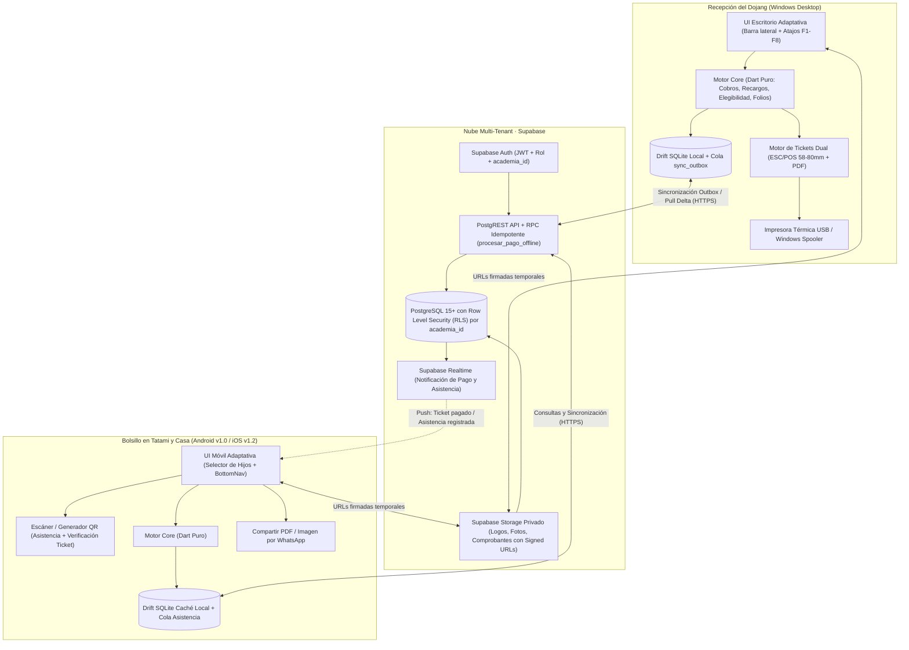
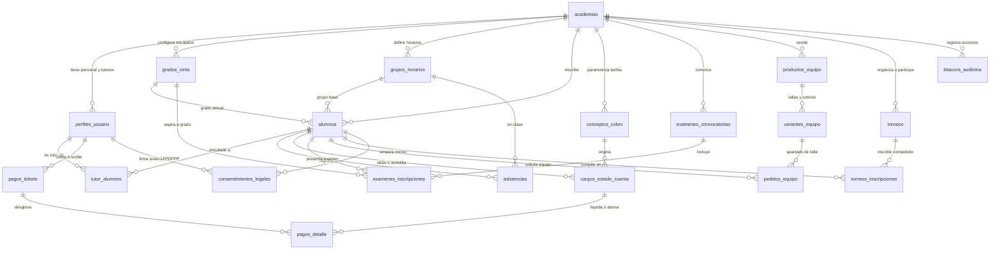

# Arquitectura · Mi Doyang by Cupa

**Versión:** 1.0 · 23 nov 2026 · Agente `arquitecto` · Decisiones detalladas en `docs/decisiones.md` (D-01 a D-12)

---

## 1. Principios arquitectónicos

1. **La caja nunca se detiene (Offline-First en recepción y asistencia).** Si el internet del dojang se cae a las 18:00 h con quince padres en fila, la PC con Windows sigue cobrando mensualidades, exámenes, equipo y torneos, imprime tickets térmicos con folio único local (`CAJA1-2026-000142`) y encola las operaciones en SQLite (`Drift`) para sincronizarlas de forma idempotente al volver la conexión.
2. **Aislamiento multi-tenant en el motor de base de datos.** Toda tabla operativa incluye `academia_id` y políticas **Row Level Security (RLS)** en PostgreSQL. Ningún error de interfaz puede filtrar datos de otra academia ni de hijos ajenos.
3. **El motor financiero y académico no sabe de pantallas ni de red (`core/`).** El cálculo de estados de cuenta, descuentos por hermanos, recargos por mora, elegibilidad de examen de grado, folios de tickets y stock de equipo vive en un paquete Dart puro (`core/`), 100% probado sin Flutter.
4. **Todo pago produce un comprobante verificable (Físico ESC/POS + Digital PDF con QR).** Nunca hay un cobro "de palabra". Cada transacción genera un registro inmutable `pagos_tickets` con desglose de conceptos (`pagos_detalle`), imprimible en papel térmico de 58/80 mm y consultable como PDF/imagen en la app Android del padre con un código QR de verificación.
5. **Las reglas de la academia son datos, no código.** El sistema de cintas (colores, puntas, meses y clases requeridas), tarifas, días de corte, recargos, descuentos familiares y logotipo se configuran por academia en base de datos.
6. **Mínimos datos personales y privacidad por diseño (LFPDPPP 2025).** Solo se solicitan los datos indispensables para la operación deportiva y escolar; las fotos y comprobantes viven en buckets privados con URLs firmadas temporales; el consentimiento del tutor queda registrado y existen herramientas ARCO de exportación y borrado en dos clics.
7. **Independencia total entre proyectos CUPA.** Este repositorio no importa código ni comparte base de datos con `marcador-tkd` ni con ningún otro proyecto. La interoperabilidad con torneos CUPA se realiza mediante exportación de archivos estándar JSON/CSV.

---

## 2. Stack tecnológico justificado

| Capa / Pieza | Elección recomendada | Por qué | Alternativa descartada |
|---|---|---|---|
| **UI y Multiplataforma** | **Flutter (Dart 3.x)** — Windows Desktop + Android (minSdk 26) en v1.0; iOS preparado para v1.2 | Un solo código para la recepción en Windows (con teclado físico e impresora USB) y la app móvil de padres e instructores en Android/iOS | React/PWA: acceso deficiente a impresoras térmicas USB/COM en Windows y menor fluidez offline en gama media |
| **Motor de negocio** | **Paquete local `core/` (Dart puro)** | Se ejecuta y prueba en milisegundos con `dart test` sin emulador ni red (patrón validado en `marcador-tkd`) | Lógica mezclada en widgets o Stored Procedures exclusivos del servidor (impediría cobrar offline) |
| **Gestión de estado** | **Riverpod (`flutter_riverpod`)** | Estado reactivo, inyección limpia de repositorios offline/online y fácil de probar | Bloc (exceso de código repetitivo) o Provider clásico |
| **Base de datos local y cola Offline** | **Drift (SQLite) + `sqlite3_flutter_libs`** | Consultas SQL tipadas en Dart, transacciones locales ACID, migraciones seguras y soporte idéntico en Windows, Android e iOS | Hive / Isar (mantenimiento abandonado o incierto y sin integridad relacional para estados de cuenta) |
| **Backend Multi-Tenant** | **Supabase (PostgreSQL 15+ / PostgREST / Auth / Storage / Realtime)** | SQL relacional real con **RLS** por `academia_id` y `tutor_id`, funciones RPC transaccionales e infraestructura administrada de bajo costo | Firebase/Firestore: modelo NoSQL inadecuado para contabilidad, saldos, inventario por tallas y reportes cruzados |
| **Impresión térmica y PDF de Tickets** | **`pdf` + `printing` + generador ESC/POS (58 mm / 80 mm)** | `pdf` construye el ticket digital con QR para WhatsApp/Android y cola de impresión de Windows; el generador ESC/POS envía bytes directos a miniprinters térmicas USB/Bluetooth | Depender solo de impresión A4/Carta o de un único SDK propietario de una marca de impresora |
| **Códigos QR (Asistencia y Verificación de Ticket)** | **`qr_flutter` (generación) + `mobile_scanner` (lectura por cámara)** | El padre muestra el QR de su hijo sin internet; el instructor escanea 30 alumnos en 2 minutos; cualquier ticket impreso se valida escaneando su QR | Lectores biométricos de huella (costosos, fallan con sudor de niños y son dato biométrico sensible bajo LFPDPPP) |
| **Almacenamiento seguro de sesión** | **`flutter_secure_storage`** | Guarda el JWT/Refresh Token de Supabase cifrado en Windows Credential Manager (DPAPI), Android Keystore y iOS Keychain | `shared_preferences` en texto plano (riesgo de robo de sesión en PCs compartidas de recepción) |
| **Compartir comprobantes** | **`share_plus` + `url_launcher`** | Enviar el ticket PDF o imagen directamente al WhatsApp del tutor desde recepción o desde la app del padre | Servidores de envío de WhatsApp Business API de pago por mensaje (innecesario en MVP v1.0) |
| **Internacionalización y formato** | **`intl` + `flutter_localizations` (`es_MX`)** | Formato de moneda en pesos (`$1,250.00 MXN`), fechas locales y preparación para otros países LATAM | Formateo manual de cadenas |

---

## 3. Diagrama de arquitectura general



---

## 4. Estructura de carpetas y módulos (`core/` y `app/`)

Siguiendo la arquitectura probada en el espacio de trabajo, el proyecto se divide en dos paquetes dentro de `gestion-academias/`:

```text
gestion-academias/
├── core/                                  # Paquete Dart puro (0 dependencias de Flutter/Supabase)
│   ├── pubspec.yaml
│   ├── lib/
│   │   ├── mi_doyang_core.dart
│   │   └── src/
│   │       ├── modelos/                   # Entidades inmutables y DTOs de dominio
│   │       ├── finanzas/                  # Motor de estado de cuenta, recargos, descuentos por hermanos, abonos
│   │       ├── tickets/                   # Generador de folios deterministas, hash de verificación QR y desglose
│   │       ├── grados/                    # Motor de elegibilidad de examen (meses, asistencias, sin adeudo)
│   │       ├── inventario/                # Control de stock por variante/talla y apartado en pedidos
│   │       └── torneos/                   # Clasificación automática de categoría (edad, peso, rama, cinta) y exportador CSV/JSON
│   └── test/                              # Pruebas unitarias rápidas (< 2 s con `dart test`)
│
└── app/                                   # Aplicación Flutter (Windows + Android + futuro iOS)
    ├── pubspec.yaml
    ├── lib/
    │   ├── main.dart
    │   ├── datos/
    │   │   ├── local/                     # Tablas Drift (SQLite), DAOs y tabla `sync_outbox`
    │   │   ├── remoto/                    # Cliente Supabase, RPCs y políticas de Storage
    │   │   └── sincronizacion/            # SyncEngine: drenado de `sync_outbox` con backoff e idempotencia
    │   ├── impresion/
    │   │   ├── ticket_pdf_builder.dart    # Maquetación PDF e imagen del comprobante con QR
    │   │   └── ticket_escpos_service.dart # Comandos ESC/POS 58mm/80mm y puente a impresora
    │   ├── pantallas/
    │   │   ├── shell/                     # AdaptiveShell: NavigationRail en Windows vs BottomNav en Android
    │   │   ├── recepcion_caja/            # Punto de venta rápido, cobro familiar, emisión de ticket y corte de caja
    │   │   ├── alumnos_familias/          # Expediente, asignación de tutores, carnet QR y consentimientos
    │   │   ├── asistencias/               # Pase de lista por escaneo QR o toque rápido por grupo/horario
    │   │   ├── cintas_examenes/           # Semáforo de elegibilidad, convocatorias, cobro y captura de calificaciones
    │   │   ├── tienda_equipo/             # Catálogo de doboks/protecciones, tallas, pedidos y entrega con ticket
    │   │   ├── torneos/                   # Convocatorias, inscripción, pesaje y exportación JSON/CSV para CUPA
    │   │   ├── portal_tutor/              # Vista móvil del padre: selector de hijos, estado de cuenta, tickets, progreso
    │   │   └── ajustes_academia/          # White-label (logo, color, cintas, tarifas, usuarios, herramientas ARCO)
    │   ├── tema/                          # Tokens visuales Dojang + ajuste dinámico de color de academia con contraste AA
    │   └── l10n/                          # Español de México (es_MX)
    ├── windows/                           # Configuración de compilación Windows Desktop
    └── android/                           # Configuración Android (com.ovrcupa.midoyang)
```

### Vistas adaptativas por plataforma y rol

| Plataforma / Rol | Disposición de navegación (Layout) | Optimización clave de experiencia |
|---|---|---|
| **Windows Desktop (`dueno`, `recepcion`)** | **Shell de escritorio** con barra lateral izquierda fija (`NavigationRail` expandido), barra superior de estado de conexión (`En línea` / `Modo sin conexión · N pendientes`) y paneles maestro-detalle a 2 o 3 columnas | **Atajos de teclado en caja:** `F2` Buscar alumno o familia, `F4` Agregar concepto/equipo, `F8` Cobrar e imprimir ticket, `Esc` Limpiar. Pensado para cobrar en menos de 15 segundos |
| **Android Móvil (`instructor`, `dueno` en tatami)** | **Barra inferior de 4 destinos:** `Asistencia QR`, `Grupos/Alumnos`, `Exámenes`, `Torneos` | Botón flotante central para abrir el **escáner QR continuo** con confirmación sonora/háptica al pasar lista en el tatami |
| **Android Móvil (`tutor` / Padre de familia)** | **Selector superior de hijos** (`[Todos] [Sofía · Amarilla] [Mateo · Verde]`) + **Barra inferior de 4 destinos:** `Inicio / Carnet QR`, `Pagos y Tickets`, `Cinta y Exámenes`, `Equipo y Torneos` | Al abrir la app, el padre ve en 1 toque el **QR de asistencia** de su hijo, su saldo del mes y el botón para descargar o compartir su último **ticket de pago** |

---

## 5. Modelo de datos multi-tenant

Todas las tablas de negocio incluyen `academia_id UUID NOT NULL REFERENCES academias(id)` y están protegidas con **Row Level Security (RLS)** en PostgreSQL.

### 5.1. Diagrama Entidad-Relación (`erDiagram`)



### 5.2. Descripción detallada de las 20 tablas del modelo

| # | Tabla | Propósito y columnas principales | Aislamiento RLS |
|---|---|---|---|
| 1 | `academias` | **Tenant raíz (Dojang).** `id (UUID)`, `nombre_comercial`, `slug`, `logo_storage_path`, `color_primario_hex`, `color_secundario_hex`, `telefono_contacto`, `direccion`, `dia_corte_mensualidad (1-28)`, `dias_gracia_recargo`, `monto_recargo_mora_mxn`, `descuento_hermano_2_pct`, `descuento_hermano_3_pct`, `prefijo_folio_default`, `leyenda_pie_ticket`, `plan_suscripcion`, `activa`, `created_at`. | Lectura para miembros de la academia; edición solo para `rol = 'dueno'`. |
| 2 | `perfiles_usuario` | **Usuarios autenticados (Personal y Tutores).** `id (UUID = auth.uid)`, `academia_id`, `rol ('dueno' \| 'recepcion' \| 'instructor' \| 'tutor')`, `nombre_completo`, `telefono`, `email`, `activo`, `created_at`. | Cada usuario ve su perfil; `dueno` y `recepcion` ven perfiles de su `academia_id`. |
| 3 | `alumnos` | **Expediente del practicante.** `id (UUID)`, `academia_id`, `codigo_matricula`, `qr_token_asistencia (UUID rotativo)`, `nombre`, `apellidos`, `fecha_nacimiento`, `rama ('femenil' \| 'varonil' \| 'otra')`, `peso_kg_actual`, `grado_actual_id`, `fecha_ultimo_examen`, `grupo_horario_id`, `foto_storage_path` (opcional), `nota_medica_emergencia` (opcional, dato sensible con consentimiento expreso), `estatus ('activo' \| 'baja_temporal' \| 'baja')`, `created_at`. | `dueno`, `recepcion`, `instructor` ven alumnos de su `academia_id`; `tutor` **solo** ve alumnos vinculados en `tutor_alumnos`. |
| 4 | `tutor_alumnos` | **Relación Familiar (1 Padre/Tutor ↔ N Hijos).** `id`, `academia_id`, `tutor_usuario_id`, `alumno_id`, `parentesco ('madre' \| 'padre' \| 'tutor_legal' \| 'propio_mayor_edad')`, `es_responsable_pagos (bool)`, `orden_hermano (1, 2, 3...)`. | `tutor` solo lee filas donde `tutor_usuario_id = auth.uid()`. |
| 5 | `grados_cinta` | **Escalafón configurable de cintas por academia.** `id`, `academia_id`, `orden_jerarquico (1..20)`, `nombre_grado` (ej. *"10.º Geup · Cinta Blanca"*, *"9.º Geup · Blanca Punta Amarilla"*), `color_hex_primario`, `color_hex_punta` (nullable), `clases_minimas_requeridas`, `meses_minimos_requeridos`, `costo_examen_sugerido_mxn`. | Lectura para toda la academia; escritura solo `dueno`. |
| 6 | `grupos_horarios` | **Clases y horarios del dojang.** `id`, `academia_id`, `nombre_grupo` (ej. *"Infantil Principiantes 17:00"*), `instructor_id`, `dias_semana (int[])`, `hora_inicio`, `hora_fin`, `cupo_maximo`, `activo`. | Lectura para toda la academia; escritura `dueno` y `recepcion`. |
| 7 | `asistencias` | **Registro de asistencia a clase.** `id (UUID)`, `academia_id`, `alumno_id`, `grupo_horario_id`, `fecha_clase (DATE)`, `hora_registro`, `metodo ('qr' \| 'manual')`, `registrado_por_id`, `client_mutation_id (UUID único para offline)`. | Índice único `(academia_id, alumno_id, fecha_clase, grupo_horario_id)` para evitar doble asistencia al sincronizar offline. |
| 8 | `conceptos_cobro` | **Catálogo de tarifas de la academia.** `id`, `academia_id`, `tipo ('colegiatura' \| 'inscripcion' \| 'examen' \| 'equipo' \| 'torneo' \| 'recargo' \| 'otro')`, `nombre`, `monto_base_mxn`, `recurrente_mensual (bool)`, `activo`. | Lectura para toda la academia; escritura solo `dueno`. |
| 9 | `cargos_estado_cuenta` | **Deudas o cargos asignados a un alumno.** `id (UUID)`, `academia_id`, `alumno_id`, `concepto_id`, `periodo_mes ('2026-11' nullable)`, `descripcion_cargo`, `subtotal_mxn`, `descuento_familiar_mxn`, `recargo_mora_mxn`, `total_cargo_mxn`, `monto_pagado_mxn`, `saldo_pendiente_mxn`, `fecha_vencimiento`, `estatus ('pendiente' \| 'parcial' \| 'pagado' \| 'condonado' \| 'cancelado')`, `referencia_origen_id` (examen/pedido/torneo). | `dueno` y `recepcion` leen/escriben en su academia; `tutor` solo lee cargos de sus hijos. (`instructor` **no** tiene acceso). |
| 10 | `pagos_tickets` | **Encabezado inmutable del Ticket de Comprobante de Pago.** `id (UUID)`, `academia_id`, `folio_visual` (ej. `CAJA1-2026-000142`), `caja_prefijo`, `consecutivo_caja`, `tutor_usuario_id` (nullable), `recibido_por_usuario_id`, `fecha_pago`, `subtotal_mxn`, `descuento_total_mxn`, `recargo_total_mxn`, `total_pagado_mxn`, `metodo_pago ('efectivo' \| 'transferencia_spei' \| 'tarjeta_terminal' \| 'mixto')`, `referencia_bancaria`, `comprobante_storage_path` (nullable), `hash_verificacion_qr (char(12))`, `pdf_storage_path` (nullable), `estatus ('emitido' \| 'cancelado')`, `motivo_cancelacion`, `cancelado_por_id`, `client_mutation_id (UUID único idempotente)`. | `dueno` y `recepcion` insertan y leen; **nadie puede hacer `DELETE`** (política RLS sin permiso de borrado); `tutor` lee los tickets de sus hijos. |
| 11 | `pagos_detalle` | **Renglones desglosados del ticket.** `id (UUID)`, `academia_id`, `pago_ticket_id`, `cargo_estado_cuenta_id`, `alumno_id`, `concepto_texto_snapshot` (ej. *"Colegiatura Noviembre 2026 — Sofía Hernández"*), `monto_aplicado_mxn`. | Misma visibilidad que `pagos_tickets`. Guarda snapshot textual para que el ticket histórico jamás cambie si luego editan el catálogo. |
| 12 | `examenes_convocatorias` | **Fechas de examen de grado.** `id`, `academia_id`, `titulo` (ej. *"Examen de Grados Invierno 2026"*), `fecha_examen`, `hora_inicio`, `sinodal_invitado`, `fecha_limite_inscripcion`, `estatus ('abierta' \| 'cerrada' \| 'finalizada')`. | Lectura para toda la academia; escritura `dueno` y `recepcion`. |
| 13 | `examenes_inscripciones` | **Alumnos inscritos y evaluados en un examen.** `id`, `academia_id`, `convocatoria_id`, `alumno_id`, `grado_actual_id`, `grado_aspirado_id`, `asistencias_cumplidas (int)`, `cumple_requisitos_auto (bool)`, `autorizado_excepcion_por_id` (si el maestro aprueba excepción), `cargo_id`, `calificacion_poomsae`, `calificacion_kyorugi`, `calificacion_basicos`, `resultado ('pendiente' \| 'aprobado' \| 'aprobado_con_mencion' \| 'no_aprobado')`, `observaciones_sinodal`, `folio_certificado`. | `instructor` puede actualizar calificaciones y observaciones; `recepcion` y `dueno` gestionan inscripción; `tutor` ve resultados de sus hijos. |
| 14 | `productos_equipo` | **Catálogo de tienda del dojang.** `id`, `academia_id`, `categoria ('dobok' \| 'protecciones' \| 'cinta' \| 'accesorio')`, `nombre` (ej. *"Dobok Cuello Negro WT"*), `descripcion`, `foto_storage_path`, `activo`. | Lectura toda la academia; escritura `dueno` y `recepcion`. |
| 15 | `variantes_equipo` | **Tallas, precios y existencias.** `id`, `academia_id`, `producto_id`, `sku_codigo`, `talla` (ej. *"000"*, *"00"*, *"140 cm"*, *"M"*), `color`, `precio_venta_mxn`, `stock_actual`, `stock_minimo_alerta`. | Lectura toda la academia; descuento automático de stock al confirmar pedido. |
| 16 | `pedidos_equipo` | **Solicitudes y entregas de uniformes/equipo.** `id`, `academia_id`, `alumno_id`, `variante_id`, `cantidad`, `precio_unitario_mxn`, `total_mxn`, `cargo_id`, `estatus_entrega ('solicitado_app' \| 'apartado_pagado' \| 'entregado_alumno' \| 'cancelado')`, `fecha_entrega`, `entregado_por_id`. | El `tutor` puede crear solicitudes (`solicitado_app`) para sus hijos; `recepcion` cobra (liga a `pagos_tickets`) y marca `entregado_alumno`. |
| 17 | `torneos` | **Eventos y torneos (internos, interclubes o federados).** `id`, `academia_id`, `nombre_torneo`, `sede`, `fecha_evento`, `fecha_limite_pago`, `costo_inscripcion_kyorugi_mxn`, `costo_inscripcion_poomsae_mxn`, `costo_ambas_mxn`, `estatus ('abierto' \| 'cerrado' \| 'finalizado')`. | Lectura toda la academia; escritura `dueno` y `recepcion`. |
| 18 | `torneos_inscripciones` | **Registro de competidores del dojang.** `id`, `academia_id`, `torneo_id`, `alumno_id`, `modalidad ('kyorugi' \| 'poomsae' \| 'ambas')`, `peso_registro_kg`, `edad_calculada_evento`, `grado_cinta_snapshot`, `rama_snapshot`, `cargo_id`, `autorizacion_tutor_firmada (bool)`, `resultado_medalla ('oro' \| 'plata' \| 'bronce' \| 'participacion' \| null)`. | `tutor` puede preinscribir y autorizar a su hijo; `instructor` valida peso (`peso_registro_kg`); `dueno`/`recepcion` exportan JSON/CSV para CUPA. |
| 19 | `consentimientos_legales` | **Evidencia de cumplimiento LFPDPPP.** `id`, `academia_id`, `usuario_id`, `alumno_id` (nullable), `tipo_documento ('aviso_privacidad_integral' \| 'datos_salud_emergencia' \| 'carta_responsiva_torneo' \| 'uso_imagen_interna')`, `version_texto`, `otorgado (bool)`, `fecha_firma`, `dispositivo_info`. | Inserción por el titular/tutor; lectura auditable por `dueno`. Registro inmutable. |
| 20 | `bitacora_auditoria` | **Rastro de seguridad inmutable.** `id`, `academia_id`, `usuario_id`, `rol_snapshot`, `accion ('cancelacion_ticket' \| 'condonacion_cargo' \| 'cambio_precio' \| 'exportacion_arco' \| 'borrado_arco' \| 'corte_caja')`, `entidad_tabla`, `entidad_id`, `datos_previos_json`, `datos_nuevos_json`, `motivo`, `created_at`. | Solo inserción mediante triggers/RPC; lectura exclusiva para `rol = 'dueno'`. |

---

## 6. Flujo detallado del Ticket de Comprobante de Pago y Sincronización Offline-First

### 6.1. Anatomía del Ticket de Comprobante de Pago

Cada ticket generado por `Mi Doyang by Cupa` contiene exactamente los mismos datos tanto en el **rollo térmico físico (58 mm u 80 mm)** como en el **comprobante digital PDF / Imagen**:

1. **Encabezado de la Academia:** Escudo/logo (en PDF y en térmico monocromo dithering), nombre comercial del dojang, teléfono y dirección.
2. **Identificación del Comprobante:**
   - **Folio único por caja:** `CAJA1-2026-000142` (prefijo de la estación asignado al dispositivo Windows/Android + año + consecutivo atómico local).
   - **Fecha y hora exacta de emisión** (con huso horario local).
   - **Atendió:** Nombre del usuario de recepción o maestro.
3. **Datos del Alumno / Familia:** Nombre del tutor responsable y por cada renglón el nombre del alumno y su grado actual (ej. *"Sofía Hernández · 8.º Geup Cinta Amarilla"*).
4. **Desglose financiero claro:**
   - Concepto(s) pagados (ej. *Colegiatura Noviembre 2026*, *Peto Electrónico Talla M*, *Inscripción Examen Invierno*).
   - Subtotal, Descuento Familiar aplicado (si corresponde), Recargo por mora (si corresponde).
   - **Total Pagado en MXN** y **Saldo Restante** (en caso de abono parcial).
   - Método de pago (*Efectivo*, *Transferencia SPEI*, *Terminal*).
5. **Sello Digital y Código QR de Verificación:**
   - Cadena codificada en el QR: `cupadojang://ticket?a={academia_id_corto}&f={folio_visual}&t={total_centavos}&h={hmac_sha256_truncado_12}`
   - Si todavía no se ha sincronizado a la nube porque el dojang estaba sin internet, el QR incluye los datos firmados localmente para que cualquier dispositivo de la academia pueda verificar su integridad matemática al instante, y al sincronizarse queda respaldado en Supabase.
6. **Pie configurable:** Leyenda de la academia (ej. *"Conserve este comprobante para su ingreso a examen o entrega de uniforme. Comprobante interno de control escolar."*).

### 6.2. Diagrama de secuencia: Cobro en Caja Offline-First y Emisión de Ticket

```mermaid
sequenceDiagram
    autonumber
    actor Padre as Padre en Recepción
    actor Recep as Recepción (Windows)
    participant Core as Motor Core + Drift SQLite
    participant Printer as Impresora Térmica / PDF
    participant Sync as SyncEngine (Outbox)
    participant Supa as Supabase (RPC + Realtime)
    participant AppPadre as App Android del Padre

    Padre->>Recep: Paga colegiatura de 2 hijos + 1 Dobok en efectivo
    Recep->>Core: Selecciona cargos y presiona F8 (Cobrar)
    Note over Core: Transacción SQLite local (<10 ms)<br/>1. Genera client_mutation_id (UUID)<br/>2. Asigna folio CAJA1-2026-000142<br/>3. Actualiza saldos en cargos_estado_cuenta<br/>4. Inserta pagos_tickets y pagos_detalle<br/>5. Encola evento en tabla local sync_outbox
    Core-->>Recep: Pago confirmado localmente
    Core->>Printer: Envía comandos ESC/POS (58/80mm) y genera PDF
    Printer-->>Padre: Entrega ticket térmico impreso con QR al instante

    alt Hay conexión a Internet en ese momento
        Sync->>Supa: RPC procesar_pago_offline(client_mutation_id, payload)
        Note over Supa: Verifica idempotencia por client_mutation_id<br/>Aplica transacción ACID en PostgreSQL<br/>Marca cargos pagados y guarda ticket
        Supa-->>Sync: 200 OK (Confirmado en nube)
        Sync->>Core: Marca registro en sync_outbox como SINCRONIZADO
        Supa-->>AppPadre: Evento Realtime + Push: "Nuevo comprobante de pago CAJA1-2026-000142"
        AppPadre->>AppPadre: Padre descarga PDF o comparte por WhatsApp
    else Se cortó el Internet en el Dojang
        Note over Sync: Detecta sin red · Mantiene en sync_outbox<br/>UI muestra "Modo sin conexión · 1 pago pendiente"
        Note over Padre,Recep: La fila avanza sin retraso; el padre ya tiene su ticket físico
        Sync->>Supa: Al volver el internet -> Drena sync_outbox en orden FIFO
        Supa-->>Sync: 200 OK (Idempotente, sin duplicar cobros)
        Supa-->>AppPadre: Notifica ticket digital al celular del padre
    end
```

### 6.3. Reglas de resolución de conflictos e idempotencia

1. **Folios sin colisión entre cajas:** Cada dispositivo autorizado para cobrar en recepción recibe al registrarse un prefijo único en la academia (`CAJA1`, `CAJA2`, `MOVIL1`). Así, si dos computadoras cobran sin internet al mismo tiempo, `CAJA1-2026-000142` y `CAJA2-2026-000089` jamás colisionan al reconectarse.
2. **Idempotencia por `client_mutation_id`:** Cada operación en `sync_outbox` (`registrar_pago`, `registrar_asistencia`, `inscribir_examen`, `entregar_equipo`) lleva un UUID generado en el cliente. La tabla remota tiene una restricción `UNIQUE (academia_id, client_mutation_id)`. Si la conexión se corta a mitad de la respuesta HTTP y el cliente reintenta enviar el pago, PostgreSQL detecta que ese `client_mutation_id` ya existe y devuelve el resultado previo sin cobrar doble.
3. **Cancelaciones en lugar de mutaciones destructivas:** Un ticket emitido nunca se edita ni se borra (`DELETE` prohibido por RLS). Si hubo un error de captura, se emite una operación `cancelar_ticket` que restaura el saldo del cargo, registra el motivo y el usuario en `bitacora_auditoria` y permite emitir un nuevo ticket correcto.

---

## 7. Estimación de costos mensuales de infraestructura

Gracias a que el procesamiento pesado (cálculo de estados de cuenta, generación de PDFs, renderizado de códigos QR y caché SQLite) ocurre en el dispositivo del cliente (Windows/Android), el consumo de servidor por academia es sumamente bajo:

| Escenario | Academias activas | Alumnos totales aprox. | Plan de Supabase necesario | Costo mensual Nube (USD / MXN aprox.) | Ingreso bruto mensual estimado (MXN) | Margen bruto de infraestructura |
|---|---|---|---|---|---|---|
| **Fase 0: Desarrollo y Piloto** (1 a 2 academias amigas) | 1 – 2 | 80 – 200 alumnos | **Supabase Free Tier** (500 MB DB, 1 GB Storage, 50,000 MAU) | **$0 USD** ($0 MXN) | $0 – $998 MXN (piloto) | ~100% |
| **Fase 1: Lanzamiento Comercial** | 3 – 40 academias | 300 – 4,000 alumnos | **Supabase Pro Tier** ($25 USD/mes: 8 GB DB, 100 GB Storage, backups diarios) | **$25 USD / mes** (~$500 MXN / mes) | $2,000 – $32,000 MXN / mes | **> 95%** |
| **Fase 2: Crecimiento Regional** | 40 – 150 academias | 4,000 – 15,000 alumnos | **Supabase Pro + Compute Micro/Small + Storage extra** | **$45 – $75 USD / mes** (~$900 – $1,500 MXN / mes) | $32,000 – $120,000 MXN / mes | **> 98%** |

*Nota sobre costos de tiendas:*
- **Google Play Console:** $25 USD pago único (ya disponible en la cuenta de desarrollador de CUPA `com.ovrcupa.*`).
- **Distribución Windows:** Instalador MSIX / InnoSetup firmado distribuido directamente a las academias clientes (o Microsoft Store con cuenta de desarrollador existente).
- **Apple Developer Program (cuando se active iOS en v1.2):** $99 USD / año (~$165 MXN / mes prorrateado), financiado con las primeras 2 academias suscritas.

---

## 8. Plan de trabajo por semanas (Semanas 1 a 8 hasta MVP v1.0)

| Semana | Foco principal | Entregables verificables |
|---|---|---|
| **Semana 1** | **Paquete `core/` (Dart puro) y Modelo de Datos** | Motor de cálculo de estados de cuenta (prorrateo, descuentos por hermanos, recargos por mora, abonos), motor de elegibilidad de cintas/exámenes, generador de folios/QR de tickets y suite completa de pruebas unitarias (`dart test` al 100%). Scripts SQL de Supabase con las 20 tablas y políticas RLS multi-tenant. |
| **Semana 2** | **Base local Drift, Sincronización Offline y Autenticación** | Esquema Drift (SQLite) en `app/`, tabla `sync_outbox`, `SyncEngine` idempotente, login con Supabase Auth (`flutter_secure_storage`), onboarding de academia (plantilla WT México de cintas, logo y colores con validación de contraste). |
| **Semana 3** | **Expedientes Familias/Alumnos y Asistencia por QR** | Alta rápida de familias (`1 tutor → N hijos`), generación de carnet con código QR offline, pase de lista con escáner `mobile_scanner` para instructores y registro manual por grupo/horario. |
| **Semana 4** | **Caja en Windows, Cobros y Motor Dual de Tickets (ESC/POS + PDF)** | Vista de punto de venta en Windows con atajos de teclado, cobro familiar unificado, impresión térmica directa 58/80 mm, generación de ticket PDF con QR de verificación, envío por WhatsApp y corte de caja por turno. |
| **Semana 5** | **Cintas, Exámenes de Grado y Tienda de Equipo** | Semáforo automático de elegibilidad para examen, convocatorias, inscripción con cargo a estado de cuenta, captura de calificaciones de examen y ascenso automático de cinta. Catálogo de uniformes/protecciones por tallas, control de stock y entrega con ticket. |
| **Semana 6** | **Torneos (con exportación CUPA) y Portal Móvil del Padre (Android)** | Módulo de torneos (inscripción, pesaje, carta responsiva y exportación JSON/CSV para software de torneos CUPA). Pulido de la vista Android para padres: selector de hijos, descarga de tickets, historial de cintas y avisos. |
| **Semana 7** | **Piloto real en Dojang + Privacidad LFPDPPP (ARCO)** | Módulo de consentimientos legales firmados por el tutor, exportación y borrado ARCO. **Prueba piloto en vivo** durante la hora pico de salida de clases en una academia aliada (cobrando en Windows con impresora térmica y padres instalando el APK de prueba cerrada). |
| **Semana 8** | **Puerta de Calidad Completa y Lanzamiento v1.0** | Ejecución rigurosa de la skill `puerta-de-calidad`: `cazador-de-bugs` (desconexión brusca de red a mitad de cobro, intentos de acceso cruzado RLS), `revisor-diseno`, `legal-privacidad-mx`, `seguridad`, `revisor-codigo`, empaquetado de instalador Windows y publicación en Google Play Store. |
