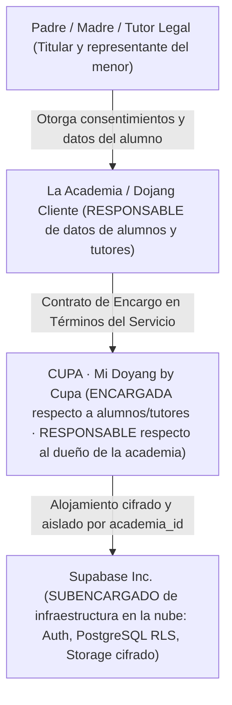

# Privacidad y Protección de Datos Personales · Mi Doyang by Cupa (Gestión de Academias TKD)

> **Aviso importante:** Este documento define la arquitectura de privacidad, el inventario de datos, la matriz de roles legales y los controles técnicos de **Mi Doyang by Cupa** siguiendo la skill `privacidad-mx`. No sustituye la asesoría jurídica profesional. Antes de superar la compuerta de lanzamiento (**C4**), un abogado especialista en derecho digital y protección de datos en México debe validar este documento y las plantillas en `legal/`.

---

## 1. Marco legal aplicable (verificado nov 2026)

1. **Ley Federal de Protección de Datos Personales en Posesión de los Particulares (LFPDPPP):** publicada en el Diario Oficial de la Federación (DOF) el 20 de marzo de 2025 y **vigente desde el 21 de marzo de 2025** (abroga y sustituye a la ley de 2010).
   - **Autoridad competente:** **Secretaría Anticorrupción y Buen Gobierno** (tras la extinción del INAI). Las resoluciones son impugnables vía juicio de amparo ante el Poder Judicial de la Federación.
   - **Disposiciones reglamentarias:** el Reglamento de la LFPDPPP continúa aplicándose en todo aquello que no se oponga a la Ley de 2025 (como los requisitos de información sobre transferencias, medidas de seguridad y procedimiento de bloqueo/supresión). *Se debe verificar antes de cada versión comercial si la Secretaría ha emitido nuevos lineamientos o reglamento.*
2. **Interés superior de la niñez y patria potestad (Código Civil Federal / correlativos estatales y LGDNNA):** dado que la mayoría de los alumnos de una academia de Taekwondo son menores de 18 años, el tratamiento de sus datos personales requiere el consentimiento verificable de quien ejerce la **patria potestad o tutela legal**, con protección reforzada sobre su imagen (fotografía) y datos de salud.
3. **Ley Federal de Protección al Consumidor (LFPC — Profeco):** aplicable a la comercialización de la suscripción SaaS de **Mi Doyang by Cupa** hacia las academias (Art. 7, 7 Bis y 76 Bis LFPC): exhibición del precio total en pesos mexicanos (MXN) con IVA incluido, periodicidad clara, identidad y domicilio del proveedor, mecanismo de cancelación directo sin penalizaciones ocultas y garantía de exportación de datos al término del servicio.
4. **Políticas de tiendas de aplicaciones:**
   - **Google Play Store:** URL pública de Aviso de Privacidad, coherencia estricta en el formulario de *Seguridad de los datos (Data Safety)*, flujo de eliminación de cuenta y datos accesible desde dentro de la app y en web, y cumplimiento de tratamiento de datos de menores autorizados por sus padres/tutores.
   - **Microsoft Store:** enlace visible al Aviso de Privacidad en la ficha de la tienda y dentro de la aplicación de escritorio para Windows.

---

## 2. ¿Quién es el responsable y quién es el encargado? (Roles legales)

El modelo de negocio de **Mi Doyang by Cupa** es una plataforma B2B2C multi-academia (*multi-tenant*). Conforme al Paso 4 de `privacidad-mx` y a la LFPDPPP 2025, la distribución de responsabilidades legales se estructura en tres niveles claramente diferenciados:

### A. Datos de alumnos, padres/tutores e instructores del Dojang
- **Responsable del tratamiento:** **La Academia de Taekwondo (Dojang cliente)** que contrata el software. La Academia es quien decide sobre la admisión de los alumnos, recaba sus inscripciones, fija las colegiaturas, organiza los exámenes de grado y determina las finalidades del tratamiento frente a las familias.
- **Encargada del tratamiento:** **CUPA** actúa exclusivamente como **Encargada** respecto de los datos personales de alumnos, padres/tutores e instructores, tratándolos por cuenta, nombre y bajo las instrucciones documentadas de la Academia.
  - La relación jurídica Responsable–Encargada se formaliza mediante el **Contrato / Cláusulas de Encargo de Tratamiento de Datos Personales** integradas en `legal/terminos.md`.
  - **Obligaciones de CUPA como Encargada:** (i) tratar los datos únicamente conforme a las instrucciones de la Academia para proveer las funciones del sistema; (ii) implementar medidas de seguridad técnicas y administrativas (RLS, cifrado, bitácoras); (iii) guardar confidencialidad; (iv) no comercializar, ceder ni transferir los datos para fines propios; (v) permitir a la Academia atender solicitudes ARCO mediante las herramientas de exportación y borrado del sistema; y (vi) devolver y suprimir los datos al concluir la relación contractual.

### B. Datos comerciales y de facturación de las Academias clientes (Relación B2B)
- **Responsable del tratamiento:** **CUPA** es **Responsable** únicamente respecto de los datos personales de identificación, contacto comercial, facturación fiscal (RFC, razón social, régimen fiscal) y control de suscripción de los **dueños, directores o administradores de las academias** que contratan la licencia de uso de **Mi Doyang by Cupa**.

### C. Subencargados / Proveedores de infraestructura en la nube
- **Supabase Inc.** (infraestructura de nube alojada sobre Amazon Web Services — EE. UU.): actúa como **Subencargado** contratado por CUPA para proveer:
  - `Supabase Auth`: autenticación y gestión de sesiones por correo/contraseña.
  - `PostgreSQL`: base de datos relacional con aislamiento lógico por academia y por rol mediante *Row Level Security (RLS)*.
  - `Supabase Storage`: almacenamiento de objetos cifrado en reposo para fotografías de perfil/credencial de alumnos y comprobantes.

---

## 3. Inventario completo de datos personales

El diseño de datos cumple el principio de **minimización**: todo campo en la base de datos responde a una finalidad operativa o de seguridad deportiva concreta.

| Dato | De quién | Finalidad | ¿Obligatorio? | ¿Sensible? | Dónde se guarda | Quién lo ve | Conservación |
|---|---|---|---|---|---|---|---|
| **Nombre completo, teléfono, correo electrónico y nombre del Dojang** | Dueño / Administrador de la academia (Cliente B2B) | Crear cuenta de la academia, administrar la licencia de Mi Doyang by Cupa, soporte técnico y avisos operativos del servicio | Sí | No | Supabase (`auth.users`, tabla `academias`) | CUPA (soporte/facturación) y el propio Dueño (`dueno`) | Vigencia de la suscripción + 5 años (plazo fiscal si hubo facturación) |
| **RFC, Razón Social, Régimen Fiscal, CP fiscal y correo de facturación** | Dueño / Administrador de la academia | Emisión de comprobantes fiscales digitales (CFDI) por la suscripción a Mi Doyang by Cupa | Opcional (solo si solicita factura) | No (Fiscal/Patrimonial) | Supabase (tabla `academias_datos_fiscales`) | CUPA (administración) y el propio Dueño (`dueno`) | 5 años conforme al Art. 30 del Código Fiscal de la Federación (CFF) |
| **Nombre completo del padre/madre/tutor** | Padre, madre o tutor legal (o alumno mayor de edad) | Identificar al titular o representante legal del alumno menor de edad, emisión de recibos de pago y contacto con la academia | Sí | No | Supabase (tabla `tutores`) | `dueno`, `recepcion`, `instructor` (solo contacto de sus alumnos) y el propio `tutor` | Mientras el alumno esté activo en la academia + bloqueo de 30 días tras baja (o 5 años solo respecto de folios contables asociados) |
| **Teléfono(s) de contacto y emergencia del tutor** | Padre, madre o tutor legal | Localización inmediata en caso de emergencia en el tatami y avisos de cobranza o actividades | Sí | No | Supabase (tabla `tutores`) | `dueno`, `recepcion`, `instructor` (en ficha de emergencia de clase) y el propio `tutor` | Mientras el alumno esté activo + bloqueo de 30 días tras baja definitiva |
| **Correo electrónico del tutor** | Padre, madre o tutor legal | Credencial de inicio de sesión en la app móvil de padres, envío de comprobantes de pago, avisos de exámenes/torneos y canal de notificaciones ARCO | Sí | No | Supabase (`auth.users`, tabla `tutores`) | `dueno`, `recepcion` y el propio `tutor` | Mientras la cuenta del tutor esté activa + bloqueo de 30 días tras solicitud de eliminación |
| **Relación parental / Declaración de patria potestad o tutela y registro de consentimiento** (`fecha_hora_utc`, `ip_dispositivo`, `version_aviso`, casillas aceptadas) | Padre, madre o tutor legal | Acreditar la representación legal del menor y demostrar el cumplimiento del consentimiento informado ante la autoridad | Sí (para alumnos menores de 18 años) | No (Evidencia legal) | Supabase (tabla `consentimientos_legales`) | `dueno`, `recepcion` (solo lectura de estado) y el propio `tutor` | Vigencia del expediente del alumno + 5 años como evidencia de cumplimiento legal |
| **Nombre(s) y apellidos del alumno** | Alumno (mayoritariamente menor de edad) | Identificación en listas de asistencia, expedientes de grado, credenciales y recibos de colegiatura | Sí | No (Dato de menor) | Supabase (tabla `alumnos`) | `dueno`, `recepcion`, `instructor` de la academia y su `tutor` (`tutor_id = auth.uid()`) | Mientras el alumno esté inscrito + periodo de bloqueo tras baja o cancelación ARCO |
| **Fecha de nacimiento del alumno** | Alumno | Calcular la edad exacta para asignarlo al grupo de entrenamiento adecuado (infantil, cadetes, juvenil, adultos) y categoría oficial de examen o torneo | Sí | No (Dato de menor) | Supabase (tabla `alumnos`) | `dueno`, `recepcion`, `instructor` y su `tutor` | Mientras el alumno esté inscrito + periodo de bloqueo tras baja |
| **Sexo / Rama deportiva** (`Femenil` / `Varonil`) | Alumno | Asignación obligatoria de rama de competencia oficial en torneos de Taekwondo (Kyorugi y Poomsae) | Sí | No (Dato de menor) | Supabase (tabla `alumnos`) | `dueno`, `recepcion`, `instructor` y su `tutor` | Mientras el alumno esté inscrito + periodo de bloqueo tras baja |
| **Peso corporal (kg)** | Alumno | Clasificación en la división de peso oficial de World Taekwondo / Federación cuando el alumno participa en combate (*Kyorugi*) | **Opcional** (solo si compite en Kyorugi) | No | Supabase (tabla `alumnos` / `inscripciones_torneo`) | `dueno`, `recepcion`, `instructor` y su `tutor` | Mientras el alumno esté inscrito; editable o eliminable en cualquier momento |
| **Fotografía del alumno** | Alumno | Identificación visual interna en el pase de lista del Dojang y generación de la credencial digital/impresa de la academia | **Opcional** (requiere casilla separada) | No (Dato de menor con protección reforzada de imagen) | Supabase Storage (bucket privado `credenciales-alumnos` cifrado) | `dueno`, `recepcion`, `instructor` de su academia y su `tutor` (mediante URL firmada temporal) | Hasta que el tutor revoque el permiso de fotografía o el alumno cause baja (eliminación inmediata del archivo en Storage) |
| **Grado / Cinta actual (Kup / Poom / Dan), asistencias e historial de exámenes y torneos** | Alumno | Control del avance marcial, elegibilidad para el siguiente examen de cinta, emisión de certificados e historial deportivo en el Dojang | Sí (generado en la operación) | No | Supabase (tablas `alumnos`, `asistencias`, `examenes_grado`, `torneos_participacion`) | `dueno`, `recepcion`, `instructor` y su `tutor` | Mientras el alumno esté activo en la academia (exportable en JSON/PDF a solicitud del tutor) |
| **Tipo de sangre** | Alumno | Referencia inmediata de emergencia médica en caso de accidente durante la práctica física o torneo | **Opcional** (con consentimiento expreso y por escrito) | **Sí — Sensible (Salud)** | Supabase (tabla `alumnos_datos_medicos` con RLS y bitácora) | `dueno`, `instructor` (ficha de emergencia en tatami), `recepcion` autorizada y su `tutor` | Eliminación inmediata si el tutor revoca el consentimiento médico o al darse de baja el alumno |
| **Alergias, lesiones previas o condiciones médicas relevantes para el entrenamiento en el tatami** | Alumno | Prevenir ejercicios de riesgo para el alumno, adaptar la carga física en clase y actuar correctamente en primeros auxilios | **Opcional** (con consentimiento expreso y por escrito) | **Sí — Sensible (Salud)** | Supabase (tabla `alumnos_datos_medicos` con RLS y bitácora) | `dueno`, `instructor` (alerta médica en tatami), `recepcion` autorizada y su `tutor` | Eliminación inmediata si el tutor revoca el consentimiento médico o al darse de baja el alumno |
| **Historial de cargos, abonos, folios de tickets de pago y método de pago** (`efectivo`, `transferencia`, `terminal externa`) | Padre / Tutor (o alumno adulto) | Control de colegiaturas, inscripciones a exámenes/torneos, emisión de estados de cuenta y comprobantes internos de pago de la academia | Sí (para control de cobranza) | No (Patrimonial administrativo) | Supabase (tablas `cargos`, `pagos`, `tickets_pago`) | `dueno`, `recepcion` y el `tutor` titular de esos pagos (`tutor_id = auth.uid()`) | 5 años (conservación contable de folios para la academia; al cancelar al titular se disocian/bloquean los datos personales del alumno) |

### Regla de minimización y datos estrictamente prohibidos
Para reducir la superficie de riesgo legal y de seguridad, **Mi Doyang by Cupa tiene prohibido solicitar o almacenar**:
1. **Datos financieros críticos:** **NUNCA** se solicitan, procesan ni almacenan números de tarjetas de crédito o débito (PAN), fechas de expiración ni códigos de seguridad (CVV/CVC). El sistema solo registra el método de pago utilizado (`efectivo`, `transferencia SPEI`, `terminal bancaria física externa`) y el folio o referencia del comprobante.
2. **Expedientes clínicos amplios:** no se piden historiales médicos generales, diagnósticos psicológicos o psiquiátricos no vinculados a la seguridad en el tatami, ni resultados de laboratorio.
3. **Otros datos sensibles o identificadores oficiales innecesarios:** no se solicita CURP del menor, religión, origen étnico, datos biométricos (ni huella dactilar ni reconocimiento facial para asistencia) ni ubicación GPS del dispositivo móvil.

---

## 4. Mecanismos de consentimiento y trazabilidad

Conforme a la LFPDPPP 2025, la aplicación implementa un sistema granular de consentimientos verificables (tabla `consentimientos_legales`), donde las casillas opcionales y de datos sensibles **nunca vienen premarcadas**:

### 4.1. Patria potestad o tutela legal (Menores de edad)
- Todo alumno menor de 18 años debe quedar vinculado obligatoriamente a un registro de `tutor` mayor de edad.
- En el flujo de registro (tanto desde la app móvil del padre como en el módulo de recepción con confirmación del tutor), el padre, madre o tutor declara expresamente bajo protesta de decir verdad que ejerce la **patria potestad o tutela legal** del menor y acepta el Aviso de Privacidad de la Academia para las finalidades primarias/necesarias.
- **Evidencia registrada en base de datos (`consentimientos_legales`):**
  - `tutor_id` y `alumno_id`
  - `nombre_firmante` y `parentesco_declarado` (`padre`, `madre`, `tutor_legal`)
  - `fecha_hora_utc` exacta del otorgamiento
  - `ip_origen` y metadatos básicos del dispositivo/cliente (`app_version`, `plataforma`)
  - `version_aviso` (hash o identificador de versión del aviso de privacidad vigente de la academia)
  - `metodo_autenticacion` (`sesion_autenticada_tutor` o `confirmacion_otp_correo`)

### 4.2. Consentimiento expreso y por escrito para datos sensibles de salud
- Los campos `tipo_sangre` y `alergias_cuidados_tatami` son **100% opcionales**.
- Para habilitar su captura y almacenamiento, la interfaz presenta una **casilla separada y desmarcada por defecto**:
  > `☐ Otorgo mi consentimiento expreso y por escrito para que la Academia trate los datos sensibles de salud de mi hijo(a)/tutorado(a) (tipo de sangre y alergias/lesiones relevantes) exclusivamente para su cuidado físico y atención de emergencias en el tatami.`
- **Requisito de forma escrita en medios electrónicos:** el consentimiento se perfecciona mediante la sesión autenticada del tutor (con contraseña o código de verificación enviado a su correo registrado) o firma electrónica en pantalla, quedando asentado en `consentimientos_legales` con sello de tiempo inmutable.
- Si el tutor no marca la casilla, el alumno puede inscribirse normalmente y los campos médicos permanecen deshabilitados (`NULL`).

### 4.3. Consentimiento separado y opcional para fotografía del menor
- La fotografía del alumno solo se utiliza para identificación interna en listas de asistencia y generación de la credencial de la academia.
- Requiere marcar una **casilla separada y desmarcada por defecto**:
  > `☐ Autorizo de forma opcional el uso de la fotografía de mi hijo(a)/tutorado(a) únicamente para su perfil interno de asistencia y credencial escolar dentro de la Academia (nunca pública en internet).`
- El tutor puede revocar este permiso y eliminar la fotografía en cualquier momento desde la app.

### 4.4. Permiso específico para inscripción a torneos o exámenes de grado
- Cuando la Academia abre una convocatoria de **Examen de Grado** o **Torneo de Taekwondo**, la inscripción de un alumno menor de edad requiere un permiso específico del padre/tutor registrado en la tabla `autorizaciones_evento`.
- Si el evento requiere compartir datos básicos del competidor (`nombre`, `fecha de nacimiento/edad`, `rama`, `grado/cinta` y `peso`) con la asociación, federación o comité organizador del torneo/examen, la pantalla de inscripción informa claramente al tutor sobre esta comunicación de datos necesaria para participar en el evento antes de confirmar su autorización.

### 4.5. Finalidades secundarias (Avisos promocionales)
- Cualquier envío de promociones comerciales, descuentos en artículos deportivos o eventos no obligatorios depende de una **casilla separada y desmarcada por defecto**:
  > `☐ Deseo recibir avisos promocionales, descuentos en equipo deportivo e invitaciones a eventos especiales de la Academia (opcional).`

---

## 5. Proveedores (Subencargados) y transferencias de datos

### 5.1. Subencargados de tratamiento (No constituyen transferencia comercial)
Para la operación técnica de **Mi Doyang by Cupa**, CUPA utiliza el siguiente proveedor de infraestructura en la nube bajo cláusulas de protección de datos y seguridad estándar de la industria:

| Proveedor | Rol legal | Servicios utilizados | Ubicación de servidores | Garantías de seguridad |
|---|---|---|---|---|
| **Supabase Inc.** (sobre infraestructura AWS) | Subencargado de CUPA | Base de datos PostgreSQL con RLS, Autenticación (`Supabase Auth`) y almacenamiento privado de archivos (`Supabase Storage`) | Estados Unidos de América (región AWS US-East / US-West) | Cifrado TLS 1.2/1.3 en tránsito, AES-256 en reposo, aislamiento por políticas RLS y acuerdos de procesamiento de datos (DPA) |

### 5.2. Transferencias de datos a terceros
- **CUPA no vende, alquila ni transfiere** datos personales de alumnos, padres o academias a terceros con fines publicitarios, de perfilamiento ni de corretaje de datos.
- **Transferencias realizadas por la Academia Responsable con autorización del tutor:**
  1. **Federaciones, asociaciones o sinodales de Taekwondo / Comités organizadores de torneos:** únicamente cuando el padre/tutor inscribe voluntariamente al alumno a un examen oficial de grado o torneo externo, se comparten exclusivamente los datos deportivos necesarios (`nombre`, `edad/categoría`, `rama`, `grado/cinta` y `peso` en caso de Kyorugi).
  2. **Autoridades competentes o servicios médicos de urgencia:** en caso de emergencia médica en el tatami (para atención hospitalaria/paramédica inmediata del alumno) o por requerimiento fundado y motivado de autoridad competente conforme a la LFPDPPP.

---

## 6. Derechos ARCO y revocación del consentimiento en el producto

Los titulares (padres/tutores por sí mismos y en representación de sus hijos menores, alumnos mayores de edad, instructores y dueños de academias) pueden ejercer sus derechos de **Acceso, Rectificación, Cancelación y Oposición (ARCO)**, así como revocar su consentimiento, en cualquier momento y de forma gratuita.

### 6.1. Responsable de atender solicitudes ARCO y canales
1. **Para alumnos y padres/tutores:** la solicitud se dirige a la **Academia (Responsable)** directamente desde la sección `Mi Perfil > Privacidad y Derechos ARCO` de la app móvil del tutor, o en la recepción/correo de privacidad de la Academia. **Mi Doyang by Cupa** provee a la Academia el panel y las funciones técnicas automatizadas para cumplir en tiempo y forma.
2. **Para dueños/administradores de academias (Clientes B2B) o solicitudes de apoyo directo:** a través del correo de privacidad de CUPA `{correo_privacidad_cupa — por definir antes de C4, ej. privacidad@midoyang.mx}` o desde el panel de configuración de la academia en la aplicación de escritorio.

### 6.2. Plazos legales obligatorios (LFPDPPP 2025)
- **Verificación de identidad:** el sistema verifica la identidad del tutor mediante su sesión autenticada o mediante identificación oficial presentada ante la Academia.
- **Plazo para comunicar la determinación:** máximo **20 días hábiles** contados desde la fecha en que se recibió la solicitud.
- **Plazo para hacer efectiva la determinación (si resulta procedente):** máximo **15 días hábiles** siguientes a la fecha en que se comunica la respuesta al titular.
- *(Ambos plazos podrán ampliarse una sola vez por un periodo igual cuando así lo justifiquen las circunstancias del caso y se notifique al titular).*

### 6.3. Funciones obligatorias integradas en el software (Mi Doyang by Cupa Desktop y App Móvil)

Para que las academias cumplan la ley sin fricción técnica, el software incluye de fábrica las siguientes funciones:

1. **Exportar expediente completo (Derecho de Acceso y Portabilidad — JSON y PDF):**
   - Disponible en la app de escritorio (`Alumnos > Ficha del Alumno/Tutor > Privacidad ARCO > Exportar expediente completo`) y solicitables desde la app móvil del tutor.
   - Genera un archivo estructurado **JSON** y un reporte legible en **PDF** que incluye: datos del tutor, datos del alumno, datos médicos registrados, historial de grados/cintas, asistencias, historial de cargos y pagos, e historial íntegro de consentimientos otorgados con sus fechas y versiones de aviso.
2. **Rectificación directa y trazable (Derecho de Rectificación):**
   - El tutor puede actualizar sus teléfonos y correo o corregir datos de su hijo(a), y la recepción/dueño puede rectificar nombre, fecha de nacimiento, peso o grado, registrando la modificación en bitácora.
3. **Revocación selectiva de consentimientos opcionales:**
   - Desde la app móvil o en recepción, el tutor puede desactivar en un clic: (a) el consentimiento de datos sensibles de salud (lo que purga de inmediato `tipo_sangre` y `alergias_cuidados_tatami`), (b) el permiso de fotografía (lo que elimina de inmediato la imagen del bucket `credenciales-alumnos`), o (c) los avisos promocionales.
4. **Eliminar / Bloquear datos de un alumno o tutor (Derecho de Cancelación y Eliminación de Cuenta):**
   - Disponible en la app de escritorio (`Privacidad ARCO > Bloquear / Eliminar registro`) y en la app móvil (`Mi Perfil > Privacidad y Cuenta > Eliminar mi cuenta y datos`).
   - Implementa el flujo legal en **dos fases** previsto por la LFPDPPP:
     - **Fase 1 — Bloqueo inmediato:** al ejecutarse la cancelación, el registro pasa a estado `bloqueado`. Se revocan sesiones activas, se borra de inmediato la fotografía de `Supabase Storage` y los datos sensibles de salud (`alumnos_datos_medicos`), y el alumno/tutor deja de aparecer en las listas de instructores y recepción.
     - **Fase 2 — Supresión definitiva y disociación contable:** tras un periodo de bloqueo de **30 días naturales** (para prevenir borrados accidentales o atender aclaraciones pendientes), un proceso automatizado elimina definitivamente los datos personales identificables del alumno y del tutor. Si existen recibos de pago históricos requeridos para la contabilidad de la academia (hasta 5 años), dichos folios se **anonimizan/disocian irreversiblemente** (`alumno_id = NULL`, `tutor_id = NULL`, reemplazando el nombre por `"REGISTRO CANCELADO ARCO #FOLIO"`) para conservar la integridad de la suma contable sin retener datos personales.

---

## 7. Medidas de seguridad técnicas, administrativas y físicas

### 7.1. Aislamiento multi-tenant y control de acceso por rol (PostgreSQL RLS)
Todas las tablas de la base de datos en Supabase tienen habilitado **Row Level Security (RLS)** por defecto (`ALTER TABLE ... ENABLE ROW LEVEL SECURITY`). Ninguna consulta desde el cliente Flutter puede eludir las políticas de aislamiento:

1. **Aislamiento estricto por Academia (`academia_id`):**
   - Todo registro pertenece a un `academia_id`. Un usuario autenticado en la Academia A jamás puede leer, insertar, actualizar ni eliminar filas cuyo `academia_id` pertenezca a la Academia B.
2. **Permisos mínimos por Rol (`dueno`, `recepcion`, `instructor`, `tutor`):**

| Rol | Alcance permitido por políticas RLS | Restricciones estrictas |
|---|---|---|
| **`dueno`** (Dueño / Director de la academia) | Lectura y escritura completa de alumnos, tutores, instructores, pagos, reportes financieros y módulo de cumplimiento ARCO **exclusivamente de su `academia_id`**. | No puede ver datos de otras academias. Sus accesos a datos médicos y exportaciones ARCO quedan grabados en bitácora. |
| **`recepcion`** (Personal administrativo) | Alta/edición de alumnos y tutores, pase de lista, registro de pagos/tickets y captura de datos médicos (solo si existe consentimiento activo) **dentro de su `academia_id`**. | No puede exportar masivamente toda la base de datos, no puede eliminar la academia ni modificar la bitácora de auditoría. |
| **`instructor`** (Profesor en tatami) | Lectura de alumnos asignados a sus clases/horarios, registro de asistencia, evaluación técnica de exámenes y visualización de la **ficha de seguridad en tatami** (tipo de sangre y alergias autorizadas) **dentro de su `academia_id`**. | **Sin acceso** a módulos financieros, ingresos globales, recibos de pago de los padres ni exportación de expedientes. |
| **`tutor`** (Padre / Madre / Tutor en App Android) | Política RLS `tutor_id = auth.uid()`: **únicamente puede leer y gestionar los datos de sus propios hijos/tutorados**, ver su propio estado de cuenta/tickets de pago, descargar sus propios comprobantes y administrar sus consentimientos. | **Bloqueo total** para consultar nombres, fotos, pagos o datos de cualquier otro alumno o tutor de la misma academia. |

### 7.2. Seguridad en dispositivos clientes (Windows y Android)
- **Almacenamiento seguro de credenciales:** los tokens de sesión (`access_token`, `refresh_token`) de Supabase se almacenan exclusivamente mediante `flutter_secure_storage` (utilizando *Android Keystore* cifrado en Android y *Windows Credential Manager / DPAPI* en Windows).
- **Prohibición de texto plano y fugas en logs:** queda prohibido guardar datos médicos sensibles o tokens en `SharedPreferences`, archivos temporales sin cifrar o imprimir payloads con nombres, teléfonos o alergias en `print()` / `debugPrint()`.
- **Protección de imágenes de menores:** el bucket `credenciales-alumnos` en Supabase Storage es **privado** (`public: false`). Las imágenes solo se sirven mediante **URLs firmadas temporales** (*Signed URLs* con expiración máxima de 60 minutos) validadas por RLS.

### 7.3. Bitácora de auditoría (`auditoria_accesos_sensibles`)
El sistema mantiene una tabla de auditoría inmutable (`INSERT` permitido vía trigger o función `SECURITY DEFINER`, sin permisos de `UPDATE` ni `DELETE` para ningún rol de la academia) que registra automáticamente:
- Creación, consulta, modificación o revocación de registros en `alumnos_datos_medicos` (`tipo_sangre`, `alergias_cuidados_tatami`).
- Ejecución de **Exportar expediente completo (JSON/PDF)**.
- Solicitud y ejecución de **Bloqueo / Eliminación ARCO** de un alumno o tutor.
- Campos registrados: `id`, `fecha_hora_utc`, `academia_id`, `actor_user_id`, `rol_actor`, `accion`, `entidad_afectada`, `registro_afectado_id`, `motivo_o_referencia`.

### 7.4. Respaldos y recuperación
- Respaldos automáticos diarios cifrados de la base de datos en Supabase con retención controlada.
- Cuando un titular ejerce su derecho de Cancelación, sus datos son purgados de la base activa y, en caso de restauración de un respaldo previo, el registro de cancelación en la bitácora ARCO vuelve a aplicar automáticamente la supresión.

---

## 8. Procedimiento ante vulneraciones de seguridad

En cumplimiento de la LFPDPPP 2025, si ocurre una vulneración de seguridad (pérdida, destrucción no autorizada, robo, extravío, copia o acceso no autorizado) en cualquier fase del tratamiento:

1. **Fase 1 — Detección y contención inmediata (0 a 4 horas):**
   - El equipo técnico de CUPA aísla el componente afectado, revoca llaves de API o sesiones JWT comprometidas, bloquea cuentas involucradas y preserva los registros de `auditoria_accesos_sensibles` y logs de Supabase.
2. **Fase 2 — Análisis de impacto (4 a 24 horas):**
   - Determinar qué `academia_id` y qué categorías de datos fueron afectadas (especialmente si involucra datos de menores de edad o datos sensibles de salud).
   - Evaluar si la vulneración **afecta de forma significativa los derechos patrimoniales o morales** de los titulares.
3. **Fase 3 — Notificación inmediata a la Academia Responsable y a los Titulares:**
   - **De CUPA (Encargada) a la Academia (Responsable):** notificación inmediata por correo electrónico y alerta crítica en el panel de escritorio de la academia.
   - **A los Titulares afectados (Padres/Tutores):** notificación inmediata tan pronto se confirme la afectación significativa, detallando en lenguaje claro:
     1. La naturaleza del incidente y la fecha/hora estimada.
     2. Los datos personales comprometidos.
     3. Las recomendaciones de acción inmediata que el titular puede tomar para protegerse.
     4. Las acciones correctivas implementadas de inmediato por CUPA y la Academia.
     5. El medio de contacto directo (correo y teléfono) para obtener más información.
4. **Fase 4 — Remediación y post-mortem:**
   - Corrección de la causa raíz, pruebas de regresión de seguridad (RLS) y documentación del informe de incidente para disposición de la Secretaría Anticorrupción y Buen Gobierno en caso de requerimiento.

---

## 9. Requisitos de tiendas (Google Play Store y Microsoft Store)

1. **Google Play Store (App móvil para padres/tutores e instructores):**
   - **URL pública del Aviso de Privacidad:** alojada en el sitio web oficial del producto y accesible sin iniciar sesión, además de estar accesible dentro de la app (`Configuración > Privacidad`).
   - **Formulario de Seguridad de los Datos (*Data Safety*):**
     - Declarar con exactitud que se recaban: Nombre, Correo electrónico, Número de teléfono, Información de salud/condición física (opcional, solo emergencias en clase), Fotos (opcional, credencial escolar) e Historial de pagos dentro de la academia.
     - Declarar que los datos **se cifran en tránsito**, que **no se comparten ni venden a terceros con fines publicitarios** y que **el usuario puede solicitar la eliminación de su cuenta y sus datos**.
   - **Eliminación de cuenta y datos:** botón funcional dentro de la app (`Mi Perfil > Privacidad y Cuenta > Eliminar cuenta y datos`) y enlace web público para solicitar la baja sin necesidad de reinstalar la app.
   - **Público objetivo en Google Play Console:** la app móvil está diseñada para ser utilizada por **padres, madres, tutores legales, instructores y administradores mayores de edad** (los menores no crean cuentas por sí mismos).
   - **Permisos de Android:**
     - `CAMERA` / Selector de fotos del sistema (*Android Photo Picker*): opcional y solicitado en contexto únicamente cuando el tutor o recepción decide tomar/subir la fotografía de la credencial del alumno.
     - Sin permisos de ubicación (`ACCESS_FINE_LOCATION`), contactos ni micrófono.
2. **Microsoft Store (App de escritorio para Windows):**
   - URL de Política de Privacidad configurada en Partner Center y accesible en la pantalla de inicio de sesión y menú `Ayuda y Legal` de la aplicación.

---

## 10. Checklist antes de publicar (Paso 7 de `privacidad-mx`)

- [x] **Inventario de datos completo y sin datos innecesarios** (documentado en la Sección 3; excluidos CURP, tarjetas/CVV y biométricos).
- [x] **Aviso integral publicado y simplificado en el registro** (redactados en `legal/aviso-privacidad-integral.md` y `legal/aviso-privacidad-simplificado.md`; pendiente alojar en URL pública antes de C4).
- [x] **Consentimientos separados:** sensibles de salud (expreso y por escrito, casilla desmarcada), financieros (no se guardan tarjetas; solo folios contables), menores (declaración de patria potestad/tutor con trazabilidad), fotos y marketing (opcionales, casillas desmarcadas por defecto).
- [ ] **Exportar (JSON/PDF) y eliminar/bloquear datos de una persona funciona en código** (diseñado como requisito obligatorio en Sección 6.3; debe verificarse en pruebas de integración antes de C3/C4).
- [ ] **Medio ARCO activo y responsable designado** (plantilla lista; falta definir el correo oficial definitivo de CUPA y los datos de cada Academia al configurar su cuenta).
- [x] **Contratos/cláusulas de encargado (academias y nube)** (Contrato de Encargo de Tratamiento redactado en `legal/terminos.md` y subencargado Supabase documentado).
- [ ] **Seguridad: TLS, roles RLS (`dueno`, `recepcion`, `instructor`, `tutor`), `flutter_secure_storage`, bitácora y respaldo** (especificados en Sección 7; deben auditarse en migraciones SQL y código Flutter antes de C3).
- [x] **Términos y condiciones con precio en MXN con IVA, cancelación y datos del proveedor (Profeco)** (redactados en `legal/terminos.md`).
- [ ] **Formularios de Play Store / Microsoft Store llenos y coherentes con el aviso** (guía lista en Sección 9 para la fase de empaquetado C4).
- [ ] **Revisión de abogado para el primer lanzamiento** (pendiente de firma antes de la compuerta C4).
